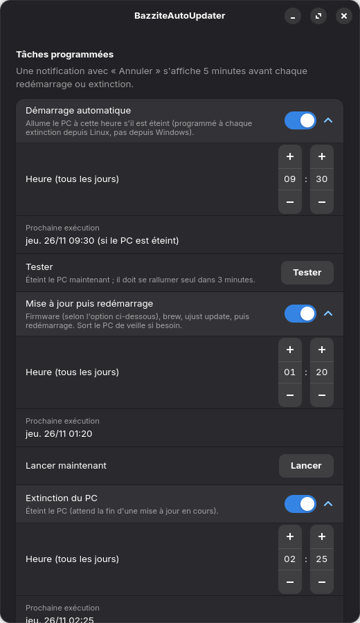
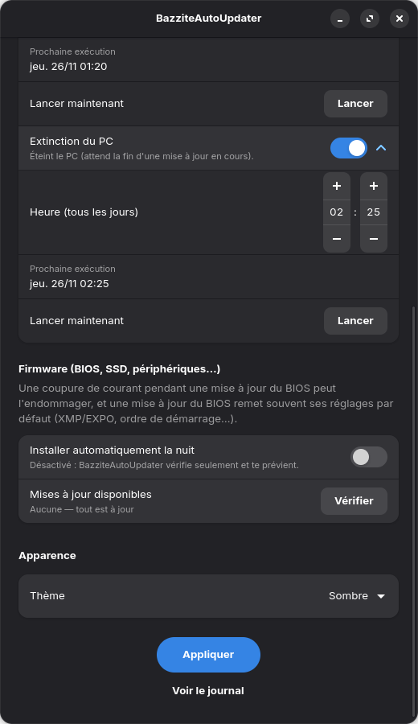
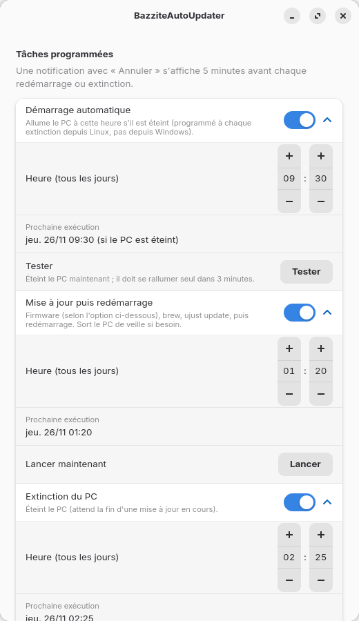

# BazziteAutoUpdater

Petite application pour **Bazzite** (et autres systèmes Universal Blue / Fedora Atomic) qui programme, chaque nuit :

0. **le démarrage automatique** du PC s'il est éteint (optionnel) ;
1. **les mises à jour** — firmware (optionnel), Homebrew, puis `ujust update` (système, Flatpak, distrobox…) ;
2. **un redémarrage** une fois les mises à jour terminées, pour les appliquer ;
3. **l'extinction du PC** à l'heure de ton choix.

Exemple : démarrage à 23h50 → mises à jour à 00h00 → redémarrage → le PC tourne (Steam peut recompiler ses shaders, etc.) → extinction à 02h00.

## Aperçu

<p align="center">
  
  
</p>

<details>
<summary>Thème clair</summary>
<p align="center"></p>
</details>

## Fonctionnalités

- Interface GTK4 / libadwaita, thème **Système / Clair / Sombre**.
- Heures réglables pour la mise à jour et pour l'extinction, chacune activable séparément.
- **Notification 5 minutes avant** chaque redémarrage ou extinction, avec les boutons « Annuler » et « Maintenant ».
- Si l'heure d'extinction arrive pendant une mise à jour, le PC s'éteint à la fin de celle-ci au lieu de redémarrer.
- **Démarrage automatique** : à chaque extinction depuis Linux, BazziteAutoUpdater programme l'horloge de la carte mère (réveil RTC, via `rtcwake`) pour rallumer le PC à l'heure choisie. Un bouton **Tester** éteint le PC et le rallume 3 minutes plus tard.
  - Si le PC ne se rallume pas, désactive **ErP Ready** dans le BIOS (sur ASUS : *Advanced → APM Configuration*).
  - Ne fonctionne pas si le PC est débranché, ni après une extinction depuis Windows (double démarrage).
- Le PC est **sorti de veille** pour la mise à jour si besoin (`WakeSystem`).
- **Firmware (BIOS, SSD…) :** BazziteAutoUpdater vérifie chaque nuit s'il existe des mises à jour (via `fwupd`).
  - Option désactivée (par défaut) : rien n'est installé, tu es prévenu par une notification, au démarrage de session et dans l'application. Tu installes toi-même avec le bouton **Installer…** de l'application (ouvre un terminal où `fwupdmgr update` demande confirmation) ou directement avec `fwupdmgr update`.
  - Option activée : les firmwares sont installés automatiquement.

  ⚠️ Une coupure de courant pendant la mise à jour d'un BIOS peut l'endommager, et une mise à jour de BIOS remet souvent ses réglages par défaut (XMP/EXPO, ordre de démarrage, Secure Boot…).
- Aucun mot de passe nécessaire à l'usage : les tâches tournent comme services systemd, et l'interface règle les minuteurs via une règle polkit limitée à un script qui valide ses arguments.
- Fonctionne même si personne n'est connecté (écran de connexion).

## Installation

```bash
git clone https://github.com/VGioM/BazziteAutoUpdater.git
cd BazziteAutoUpdater
./install.sh        # demande le mot de passe sudo une seule fois
```

Lance ensuite **BazziteAutoUpdater** depuis le menu des applications, règle les heures, puis clique sur **Appliquer**.

Désinstallation : `./uninstall.sh`

### Dépendances

Déjà présentes sur Bazzite : `python3-gobject`, GTK4, libadwaita, `fwupd`, `jq`, `notify-send`, `uupd`. Homebrew est utilisé s'il est installé.

## Conseil : compiler les shaders Steam la nuit

Après une mise à jour du pilote graphique, Steam recompile les shaders de tous les jeux (processus `fossilize_replay`), ce qui peut saturer le processeur pendant un bon moment. Pour que cela se fasse la nuit, entre le redémarrage et l'extinction :

- active la **connexion automatique** (Paramètres système → Connexion (SDDM)) ;
- laisse Steam se lancer au démarrage de la session.

## Fonctionnement

| Fichier installé | Rôle |
|---|---|
| `/usr/local/bin/bazzite-autoupdater-job` | Exécute les tâches (root) : `update`, `poweroff`, `check-firmware`, `set-wake`, `test-wake` |
| `/usr/local/bin/bazzite-autoupdater-helper` | Appelé par l'interface via `pkexec` : écrit les minuteurs et les réglages |
| `/etc/systemd/system/bazzite-autoupdater-{update,poweroff}.{service,timer}` | Services et minuteurs systemd |
| `/etc/polkit-1/rules.d/49-bazzite-autoupdater.rules` | Autorise le groupe `wheel` à lancer `bazzite-autoupdater-helper` sans mot de passe |
| `/etc/systemd/system/bazzite-autoupdater-wake.service` | Programme le démarrage automatique à chaque extinction |
| `/etc/bazzite-autoupdater/bazzite-autoupdater.conf` | Réglages (`AUTOUPDATER_USER`, `FIRMWARE_UPDATE`, `BOOT_TIME`) |
| `/var/lib/bazzite-autoupdater/firmware-disponible.txt` | Dernière liste des firmwares disponibles |
| `/var/log/bazzite-autoupdater.log` | Journal |
| `~/.local/bin/bazzite-autoupdater` | L'interface |
| `~/.config/autostart/bazzite-autoupdater-notify.desktop` | Notification « firmware disponible » à l'ouverture de session |

Commandes utiles :

```bash
systemctl list-timers 'bazzite-autoupdater-*'   # prochaines exécutions
tail -f /var/log/bazzite-autoupdater.log         # suivre le journal
```

## Licence

MIT — voir [LICENSE](LICENSE).
